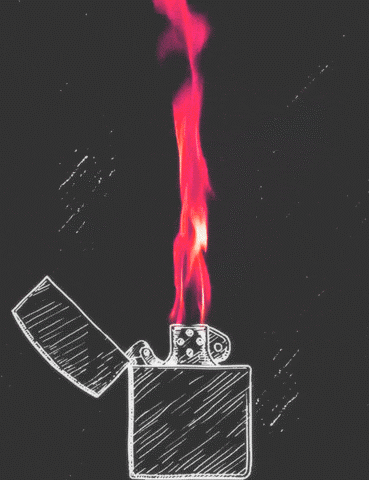

<!-- ═══════════════════════════════════════════════════════════════════════ -->
<!-- FLAME IN FREEFALL — FINAL PREMIUM README                                -->
<!-- ═══════════════════════════════════════════════════════════════════════ -->

<div align="center">

<!-- Tumhari Downloaded GIF -->



<h1>FLAME IN FREEFALL</h1>
<h3><em>SI-Powered Fire Safety Insights from Microgravity Combustion Data</em></h3>

<p>
  <a href="https://www.spaceappschallenge.org/"></a>
  
  
  
</p>

<p>
  
  
  
  
  
</p>

<br>

> **"In microgravity, there is no buoyancy. Flames are spherical and blue — invisible to traditional sensors. We built the tool to make them visible."**

[**Explore the Dashboard**](#-getting-started) · [**View Architecture**](#-system-architecture) · [**Read the Science**](#-the-science-behind-the-code)

</div>

---

## 📖 Table of Contents
- [The Crisis](#-the-crisis)
- [Our Solution](#-our-solution)
- [Core Innovations](#-core-innovations)
- [System Architecture](#-system-architecture)
- [The Science Behind the Code](#-the-science-behind-the-code)
- [Getting Started](#-getting-started)
- [Tech Stack & Constraints](#️-tech-stack--constraints)
- [Data Attribution](#-data-attribution)

---

## 🚨 The Crisis

NASA's Physical Sciences Informatics (PSI) database contains over **12 Terabytes of combustion data** spanning 40 years (24 core experiments). 

Yet, a critical bottleneck remains: **Mission engineers do not have time to read it.**

When designing the Artemis Lunar Habitat, engineers face an unprecedented threat:
- **Oxygen-Rich Environment:** Lunar habitats will run at **30%+ O₂ at ≤10.2 psi**.
- **The Flammability Spike:** This atmosphere makes materials **over 40% more flammable** than on Earth.
- **The Detection Blackout:** In microgravity, the absence of buoyancy means fires don't form teardrop shapes; they form slow-moving, blue, spherical flames that evade legacy smoke detectors (as seen in the Apollo 1 and Mir incidents).

**The Challenge:** Build an interactive SI-powered dashboard that summarizes, ranks, and interprets this data to deliver actionable fire safety insights.

---

## 💡 Our Solution

We did not build a static dashboard. We built a **Mission-Aware Decision Support Tool.**

**Flame in Freefall** dynamically parses NASA's normalized data and adapts its UI, ranking algorithms, and predictive models based on the specific mission profile selected by the user.

---

## ✨ Core Innovations

<table>
  <tr>
    <td width="50%">
      <h3>🎯 1. Mission-Aware Re-Ranking</h3>
      <p>Stop manually filtering. Select <em>"Lunar Base"</em> and the dataset instantly re-weights. High-O₂ experiments (like CFI-G) shoot to #1. Switch to <em>"Spacecraft / ISS"</em> and large-scale tests (like Saffire-I) take the lead. <strong>Same data, different priority.</strong></p>
    </td>
    <td width="50%">
      <h3>⚠️ 2. Automated Gap Analysis</h3>
      <p>We don't just show what NASA <em>has</em> tested. Our engine scans the dataset to find blind spots (e.g., <em>"No solid-fuel experiment exceeds 30% O₂"</em>). This provides a forward-looking research roadmap for Artemis planners.</p>
    </td>
  </tr>
  <tr>
    <td width="50%">
      <h3>🎚️ 3. Predictive Fire Model</h3>
      <p>An interactive sandbox with O₂, pressure, and fuel-type sliders. The engine predicts flame propagation and extinction risks calibrated directly against the actual findings of <strong>SAME (2019)</strong>, <strong>CFI-G (2021)</strong>, and <strong>FLEX (2012)</strong>.</p>
    </td>
    <td width="50%">
      <h3>🔧 4. Hardware Recommendations</h3>
      <p>We translate data into engineering. Based on the active mission, the tool recommends concrete hardware choices: <em>fine water mist vs. CO₂ suppression</em>, detector placement geometry, and safe material selection.</p>
    </td>
  </tr>
</table>

---

## 🏗️ System Architecture

Built with a focus on **speed, reliability, and zero API dependencies** for deep-space latency scenarios.

```mermaid
graph TD
    %% Data Layer
    subgraph Data Layer
        A[NASA PSI Database<br/>~12 TB] -->|Normalization| B(JSON Payload<br/>20+ Investigations)
    end

    %% Logic Layer
    subgraph Vanilla JS Engine
        B --> C{Router & State Manager}
        C -->|Scenario Select| D[Re-Ranking Algorithm<br/>Weighted Scoring]
        C -->|User Query| E[Intent-Based SI Matcher<br/>Regex & Keyword Scoring]
        C -->|Sandbox Input| F[Predictive Physics Engine<br/>SAME/CFI-G Rules]
    end

    %% Presentation Layer
    subgraph UI Layer
        D --> G[Glassmorphism Cards]
        E --> H[Typing Chat Interface]
        F --> I[Live Risk Verdict]
        G --> J[Chart.js Analytics]
        G --> K[Mission Brief Generator]
    end

    style A fill:#0b3d91,stroke:#fff,color:#fff
    style B fill:#ff6b35,stroke:#fff,color:#fff
    style C fill:#4ecdc4,stroke:#fff,color:#000
    style J fill:#1e293b,stroke:#fff,color:#fff
